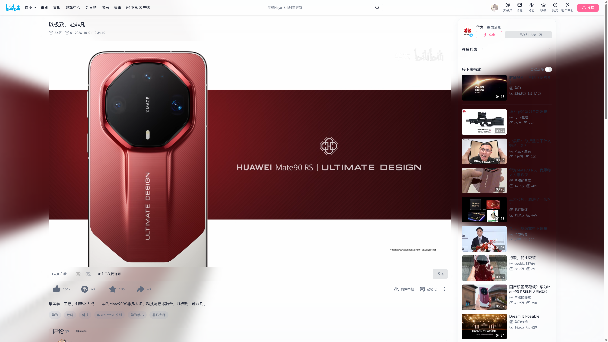
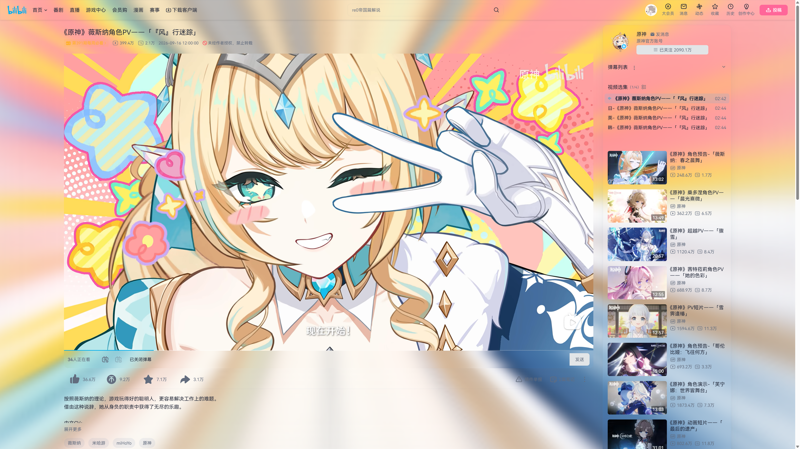
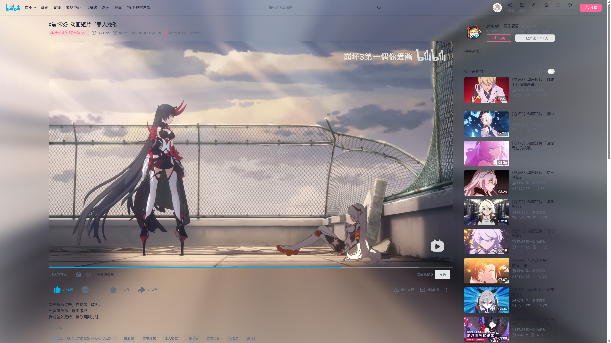
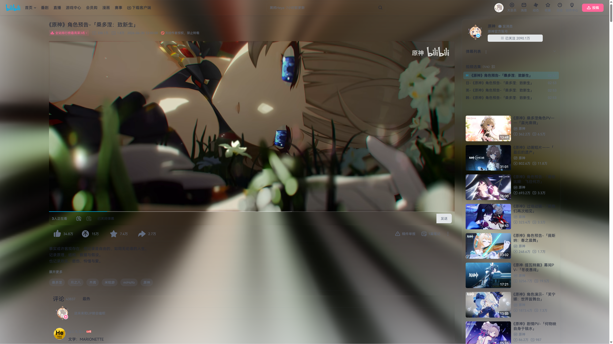
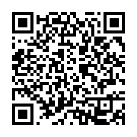
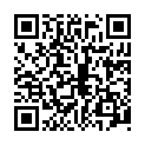

# Bili Liquid Glass

[简体中文](README.md) · [English](README.en.md) · [日本語](README.ja.md) · [한국어](README.ko.md)

为 Bilibili 视频和番剧观看页添加随画面变化的氛围光，以及可调透明度的玻璃主题。支持桌面 Chrome、Edge，视频画面只在你的设备上处理。

**源码版本：0.1.23 · 源码公开、非商业许可**

## 效果图

| 普通视频氛围光 | 明亮彩色扩散 |
| --- | --- |
|  |  |
| 柔和氛围光 | 深色沉浸效果 |
|  |  |

## 下载与安装

[下载扩展（Chrome / Edge）](https://github.com/Kiana-Zhang/bili-liquid-glass/releases)

在 Releases 中选择对应浏览器的安装包。GitHub 自动提供的「Source code」是源码压缩包；安装扩展请下载对应版本的 Chrome／Edge ZIP。

1. 将安装包解压到一个你准备长期保留的文件夹。
2. 在 Chrome 地址栏输入 `chrome://extensions`；Edge 输入 `edge://extensions`。
3. 开启「开发者模式」，点击「加载已解压的扩展程序」或「加载解压缩的扩展」。
4. 选择解压后直接包含 `manifest.json` 的文件夹。
5. 刷新已打开的 Bilibili 视频或番剧页面。

请保留解压目录，浏览器会从这个目录加载扩展。安装方式需要开发者模式，但日常使用无需运行命令或安装 Node.js。

## 可以做什么

- 将视频颜色柔和地扩散到画面周围，同时保留完整视频，不裁切或拉伸。
- 为观看页的导航、信息区、侧栏、评论及常见弹层添加玻璃主题。
- 明暗主题跟随系统，也可手动选择浅色或深色。
- 支持普通、宽屏、网页全屏和浏览器全屏；全屏时光效显示在视频以外的可用空间。
- 暂停时保留最后的氛围光；标签页隐藏、画中画和悬浮小窗等情况下停止动态采样。

开启「沉浸光感」也会隐藏部分广告、活动资源块及投票组件。这是观看页外观的一部分，不覆盖网站所有广告。

## 调整效果

点击浏览器工具栏中的扩展图标，或播放器控制栏的「✦ 光感」，即可打开设置。找不到工具栏图标时，可在浏览器的扩展菜单中将它固定。

| 设置 | 使用说明 |
| --- | --- |
| 语言 | 在面板顶部选择简体中文、English、日本語或한국어，即时生效并保存。默认简体中文；关闭光效后也能切换，恢复默认会保留当前语言。 |
| 沉浸光感 | 同时开启或关闭氛围光和玻璃主题。关闭后恢复网站原有外观。 |
| 透明度 | 越高，玻璃越透明、氛围光越强。默认 65；设为 0 时光效消失，但玻璃背景模糊仍会保留。 |
| 范围 | 调整光效向外扩散的距离，范围为 0–200。 |
| 柔和度 | 调整光效过渡的柔和程度。 |
| 扩散方向 | 在直向与斜向投影之间选择。 |
| 主题 | 跟随系统、浅色或深色。 |
| 画质档位 | 默认「均衡」；设备负担较大时选择「省电」，希望光效更细致时选择「细腻」。 |

页面菜单支持点击外部关闭，也可按 Esc 关闭。修改会自动保存，页面菜单与扩展弹窗共享同一份设置。Chrome 和 Edge 分别保存各自的偏好，不进行账号同步。

## 支持范围

- 支持 `www.bilibili.com/video/*` 普通视频，以及 `www.bilibili.com/bangumi/play/*` 番剧、影视观看页。
- 支持桌面 Chrome 和 Edge；扩展声明的最低 Chromium 版本为 121，建议使用浏览器的当前稳定版本。最低版本尚未完成逐项实机验证。
- 直播域名、首页主题、移动浏览器和第三方嵌入播放器不在支持范围内。
- 视频自带黑边会参与颜色扩散，不自动裁切；目前没有 HDR 专门校正。
- 网站改版、不同账号获得的页面版本及其他主题／播放器扩展可能影响效果。

## 更新与卸载

**更新：** 下载新版本，将安装包解压至原安装目录并替换旧文件；在扩展管理页点击「重新加载」，随后刷新 Bilibili 页面。继续使用原安装目录可以保留现有设置。

**暂时停用：** 关闭设置中的「沉浸光感」。也可以在浏览器扩展管理页禁用扩展，并刷新页面。

**卸载：** 在扩展管理页点击「移除」，然后刷新 Bilibili 页面。浏览器会清除扩展保存的设置，解压目录可自行删除。

## 常见问题

**安装后没有变化？**

确认扩展已启用、「沉浸光感」已打开，并刷新支持的观看页。扩展安装或重新加载后，之前打开的页面需要刷新。若浏览器限制了此扩展的站点访问，请允许它访问 `www.bilibili.com`。

**有玻璃主题，但没有动态光效？**

先检查透明度是否为 0。某些视频限制画面读取或使用受保护媒体，扩展会停止动态光效并显示原因，玻璃主题仍可使用。全屏视频铺满屏幕时，外围没有可显示光效的空间；悬浮小窗和画中画期间也会停止动态采样。

**感觉卡顿、耗电或风扇声音变大？**

将档位改为「省电」，或暂时关闭「沉浸光感」。不同设备、分辨率和其他扩展会影响实际性能。

**页面布局或文字显示异常？**

先关闭「沉浸光感」并刷新页面，确认是否存在其他主题或播放器扩展的影响。可以通过 [GitHub Issues](https://github.com/Kiana-Zhang/bili-liquid-glass/issues) 反馈，附上浏览器版本、问题页面、操作步骤与设置；截图前请遮挡个人信息。

## 隐私与自愿支持

视频帧在本机处理，不上传、不保存为截图。设置仅保存在当前浏览器，不收集观看记录、账号资料或设备统计，也没有遥测和分析服务。详细信息见 [隐私说明](PRIVACY.md)。

设置面板中的打赏入口完全自愿，不影响功能。支付宝和微信二维码在本机生成；标有 PayPal 图标的入口会打开 Ko-fi 页面。付款由对应支付应用或网站处理，扩展不会自动付款，也不会读取付款信息。

| 支付宝 | 微信 | Ko-fi / PayPal |
| --- | --- | --- |
| [打开支付宝收款链接](https://qr.alipay.com/fkx139599r7p33uofsallfa?0&T=58744-10-24%2006:29:28) | [查看微信收款二维码](assets/support/wechat.png) | [前往 Ko-fi 打赏](https://ko-fi.com/yanami_annna) |

| 支付宝 | 微信 |
| --- | --- |
|  |  |

以上链接与二维码和插件内完全一致。微信请使用微信扫一扫；PayPal 图标入口对应 Ko-fi，并非独立 PayPal 收款地址。

## 从源码构建

安装 Node.js 后，在项目目录运行 `npm ci` 和 `npm run build`，然后加载 `dist/chrome` 或 `dist/edge`。运行 `npm run check` 检查类型、单元测试、构建和浏览器回归，`npm run test:i18n` 检查四种语言、同步保存及窄面板布局。源码版本可能领先于 Releases，新增功能可通过本地构建体验。

## 使用许可

本项目自有代码和文档采用 [PolyForm Noncommercial 1.0.0](LICENSE)，版权所有 © 2026 Kiana-Zhang。

允许按条款进行非商业使用、修改与分发，包括个人学习、娱乐和爱好项目；分发时须保留许可和必要声明。条款还允许其列明的公益、教育、公共研究等机构使用。商业用途不在此许可授权范围内。这里的中文说明仅便于理解，具体权利与义务以完整许可为准。

第三方组件保留各自的许可及权利声明，详见 [第三方声明](THIRD_PARTY_NOTICES.txt)。本项目与 Bilibili、PayPal、支付宝、微信或 Ko-fi 没有官方关联。
